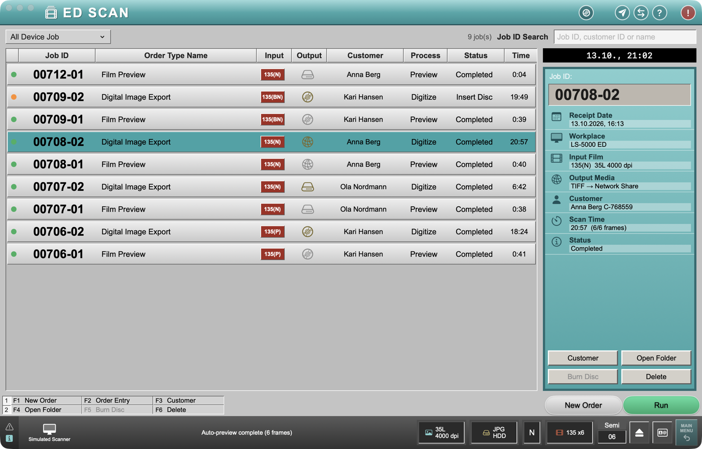
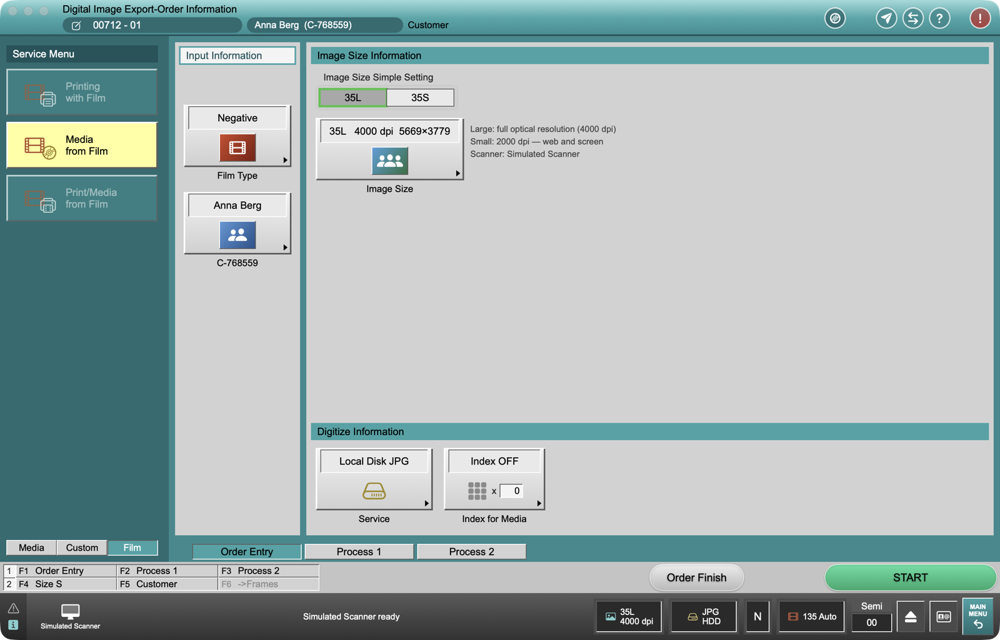
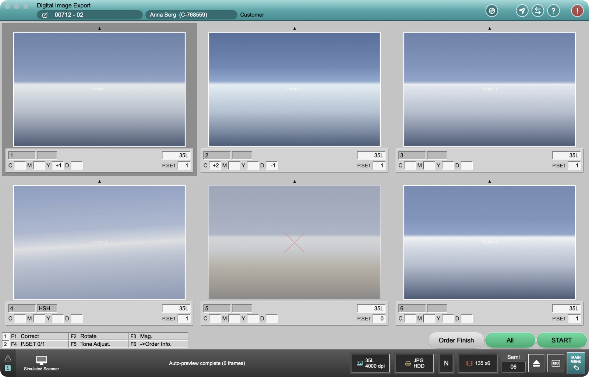
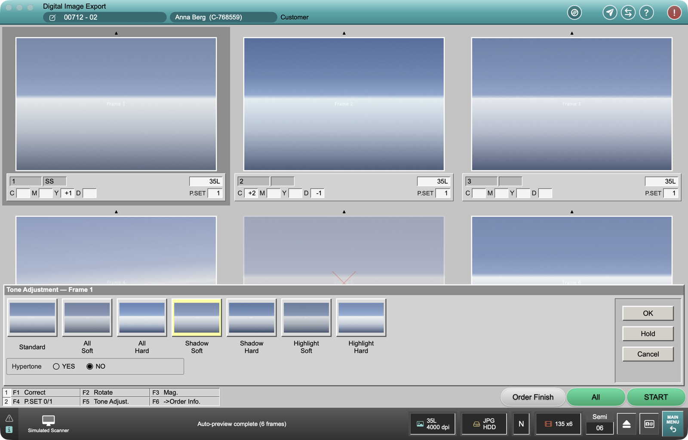
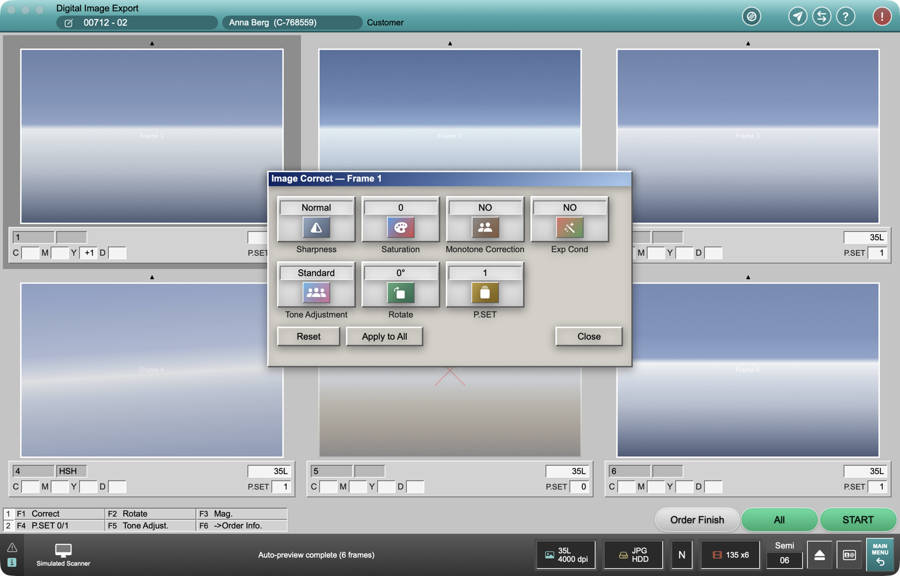
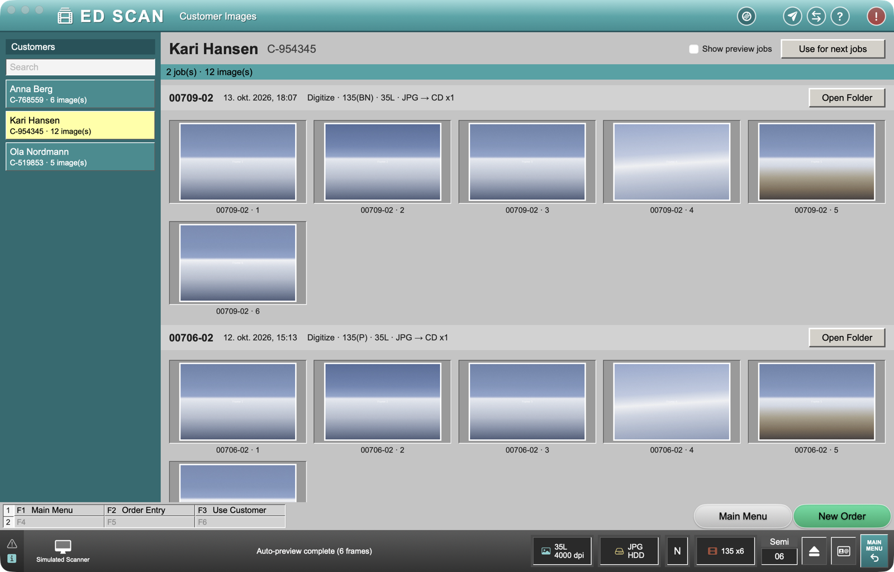

# ED Scan

A professional, keyboard-fast macOS scanning station for Nikon Coolscan film scanners — laid out like a Fujifilm Frontier "Digital Image Export" workstation. Built on [CoolscanKit](https://github.com/EDalhus/CoolscanKit), the scanner core shared with [OpenCoolscan](https://github.com/EDalhus/OpenCoolscan).

> **Beta.** Not affiliated with Nikon Corporation or Fujifilm.



## Screenshots

| | |
| --- | --- |
|  |  |
| **Order Entry** — film type, image size, output service and customer, remembered between films | **Frame check** — per-frame C/M/Y/D, tone code and P.SET (frame 5 skipped) |
|  |  |
| **Tone Adjustment** — seven tone curves previewed on the actual frame, plus Hypertone | **Image Correct** — sharpness, saturation, monotone, auto exposure, rotate, P.SET |
|  | |
| **Customer Images** — every image from every job of a customer | |

<sub>Screenshots use the built-in Simulated Scanner, so the frames are placeholder images.</sub>

## Download

Get the latest build from [**Releases**](https://github.com/EDalhus/EDScan/releases) (`ED-Scan-<version>.zip`), unzip it and move **ED Scan.app** to Applications.

The app is not notarized yet, so macOS blocks the first launch. Either right-click the app → **Open** → **Open**, or run:

```bash
xattr -dr com.apple.quarantine "/Applications/ED Scan.app"
```

**Requirements:** macOS 13 or later (Apple silicon or Intel). Real scanners need SANE: `brew install sane-backends`. Without a scanner, pick **Simulated Scanner** in the status bar.

## How it works

A Frontier-style flow where every run is a job:

1. **Order Entry** — film type (negative / positive / B&W), image size (35L = full optical resolution, 35S = 2000 dpi), output service (local disk, network share or CD/DVD, JPG or TIFF), index sheet and customer. Everything is remembered until you change it.
2. **START** — a *preview job* previews every frame on the strip.
3. **Frame check** — per-frame C/M/Y/D keys, tone adjustment (Standard, All Soft/Hard, Shadow Soft/Hard, Highlight Soft/Hard, Hypertone), saturation, sharpness, monotone, auto exposure, rotate, and P.SET 0 to skip a frame. **All** copies one frame's corrections to the rest.
4. **START** — a *scan job* scans at full resolution and records how long the scan took. Files are written in the background while you load the next film.

- **Job list** (main menu): every preview and scan job with its own ID (`00718-01`, `-02`, …), date, input (`135(N)`), output media, customer, status and scan time. Search by job ID, customer ID or name.
- **Customers**: give a name and the customer gets a random ID (`C-482913`). It is attached to every following job and written into each file's IPTC/EXIF metadata. **Customer Images** shows every image from every job of a customer.
- **Output**: `<folder>/<Customer ID Name>/<Job ID>/<Job ID>_<frame>.jpg|tif`, optional 16-bit TIFF and contact sheet. CD/DVD output is staged and burned with `drutil`.
- **Semi / Auto**: Semi stops at frame check; Auto scans straight after the preview.

### Keys

| Key | Action |
| --- | --- |
| F1–F6 | Function keys shown in the bar (fn + F-key on Mac keyboards) |
| Return | START |
| ← → ↑ ↓ | Select frame |
| Q/A · W/S · E/D · R/F | C · M · Y · D  + / − |
| Space | P.SET 0/1 |
| T | Tone Adjustment (1–7 choose, H hypertone) |
| 0 | Reset frame corrections |
| Esc | Close panel / back |

## Known limitations (beta)

- CD/DVD burning and network shares are untested on real hardware.
- Only 35 mm (135) film.
- Digital ICE is switched off automatically when the holder/mode doesn't support it.
- If the scanner stops responding, ED Scan offers to stop a stuck `scanimage` process; otherwise switch the scanner off and on.

## Data

Jobs and customers: `~/Library/Application Support/ED Scan`. Settings: `no.dalhus.edscan` user defaults.

## Build from source

```bash
./build.sh            # universal ED Scan.app
./build.sh --release  # also ED-Scan-<version>.zip
open "ED Scan.app"
```
